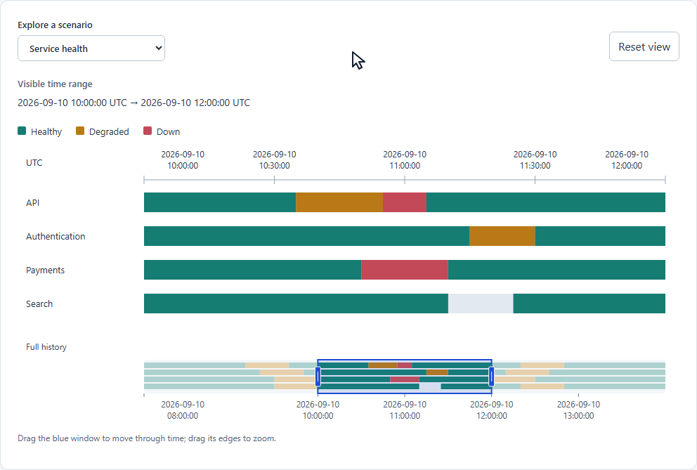

# State Explorer

An embeddable timeline for exploring **entity × time × discrete state**: services
becoming degraded, builds moving through phases, or devices going offline.
Your application supplies the entities, state intervals and colors. State Explorer
aligns their histories on a shared time axis with inspection, zoom, pan and an
overview navigator.

The framework-independent TypeScript core handles validation and projection;
the React package renders responsive SVG. The `0.1.0` API is experimental.

**Publication status: 0.1.0 is prepared but not yet published to npm.**



Start with the full history, move the blue viewport window to another period,
resize its right edge to zoom, then hover a detail interval to inspect its state
and original time bounds. The recording uses the real local demo.

## Install

Use `@state-explorer/react` with `@state-explorer/core` for the React timeline and
overview navigator. Use core alone for framework-independent validation and projection.

Intended npm command (use only after publication):

```sh
npm install @state-explorer/core@0.1.0 @state-explorer/react@0.1.0
```

Your app supplies React 18 or 19 and a renderer such as `react-dom` of the same
major. To evaluate the packages now, [build and install local tarballs](packages/react/README.md#local-tarball-installation)
or run the demo below.

## Try the demo

Use Node.js 24 and npm for the development tools:

```sh
git clone https://github.com/AlbertDavletov/state-explorer.git
cd state-explorer
npm ci
npm run example
```

Open `examples/demo/dist/index.html` in a browser. Service health, build pipelines
and device states use the same component. No server or external data source is
needed. See the [demo guide](examples/demo/README.md).

## Quick Start

Render this component in a React 18 or 19 application with both packages installed.
The local demo already provides React and mounting code.

```tsx
import { useState } from "react";
import { StateTimeline } from "@state-explorer/react";
import type { Entity, StateInterval, TimeRange } from "@state-explorer/core";

const start = Date.parse("2026-09-10T10:00:00Z");
const end = Date.parse("2026-09-10T12:00:00Z");
const hour = 60 * 60_000;
const domain = { start: start - 2 * hour, end: end + 2 * hour };
const entities: Entity[] = [{ id: "api", label: "API" }, { id: "worker", label: "Worker" }];
const intervals: StateInterval<"healthy" | "degraded">[] = [
  { entityId: "api", start: domain.start, end: start, state: "healthy" },
  { entityId: "api", start, end: start + hour, state: "degraded" },
  { entityId: "api", start: start + hour, end, state: "healthy" },
  { entityId: "api", start: end, end: domain.end, state: "degraded" },
  { entityId: "worker", start: domain.start, end: domain.end, state: "healthy" },
];
const appearance = {
  healthy: { fill: "#167d73", label: "Healthy" },
  degraded: { fill: "#b87916", label: "Degraded" },
};

export default function Example() {
  const [viewport, setViewport] = useState<TimeRange>({ start, end });
  return <div style={{ width: "100%", maxWidth: 900 }}>
    <StateTimeline entities={entities} intervals={intervals} viewport={viewport} domain={domain}
      onViewportChange={setViewport}
      label="Service state history" getStateAppearance={interval => appearance[interval.state]} />
  </div>;
}
```

The initial viewport is 10:00–12:00 UTC within an 08:00–14:00 domain, so the overview
window can move and resize immediately. `viewport` is controlled: interactions
call `onViewportChange` with proposals, and your application accepts, constrains
or rejects them. Only updated props move the chart. Omitting `domain` hides the
overview; omitting the callback disables navigation while preserving inspection.

Times are finite Unix epoch milliseconds. Intervals are nonempty and **half-open
`[start, end)`**: the start is included and the end excluded. Adjacent states may
share a boundary; gaps do not imply a state. The
[checked example](examples/demo/quick-start.tsx) matches this Quick Start in tests.

See the [core reference](packages/core/README.md) for types, validation and
projection, and the [React reference](packages/react/README.md) for props,
interaction controls and accessibility behavior.

## Development checks

```sh
npm test
npm run typecheck
npm run example
npm run test:browser
npm run check:packages
```

First run `npx playwright install chromium`, or
[select installed Microsoft Edge](examples/demo/README.md#browser-checks).
[GitHub CI](.github/workflows/ci.yml) runs these checks on pull requests and `main`
using Node.js 24, Ubuntu and Chromium. `check:packages` installs local tarballs in
isolated React 18/19 consumers and exercises the copied README Quick Start at
1000/360px, including viewport movement, both resize edges and inspection.
It requires registry access or cached dependencies; it does not publish.

## Limits

Packages emit ES2022 ESM for modern browsers, without polyfills. Other browser
engines, real screen readers, physical touch and large-data performance remain
unvalidated. Overlaps paint in input order; tiny pointer targets, clipped labels
and tooltip edge/overflow clipping remain limitations. See the
[React contracts and limits](packages/react/README.md#accessibility-and-limits).
There is no aggregation, virtualization, touch-pinch navigation or data backend.

## Background

State Explorer builds on the temporal exploration idea of the earlier
[Availability Explorer Plugin](https://github.com/AlbertDavletov/Availability-Explorer-Plugin).
It has a newly designed, domain-neutral TypeScript/React implementation and a
framework-independent core.

## License

[MIT](LICENSE), copyright 2026 Albert Davletov.
