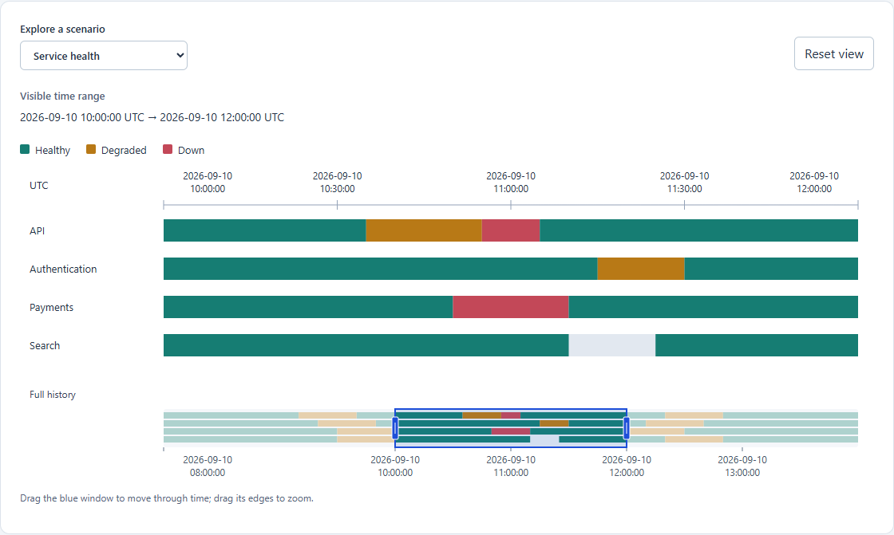

# State Explorer

An embeddable timeline for exploring **entity × time × discrete state**: services
becoming degraded, builds moving through phases, or devices going offline.
Your application supplies the entities, state intervals and colors. State Explorer
aligns their histories on a shared time axis with inspection, zoom, pan and an
overview navigator.

The framework-independent TypeScript core handles validation and projection;
the React package renders responsive SVG. Both packages are **experimental and
unpublished**, with version `0.0.0` and `private: true`. This repository is a source
publication; the package names are not yet available to install from npm.



## Try the demo

Use Node.js 24 and npm for the development tools:

```sh
git clone https://github.com/AlbertDavletov/state-explorer.git
cd state-explorer
npm ci
npm run example
```

Open `examples/demo/dist/index.html` in a browser. Switch between service health,
build pipelines and device states. Drag the overview window to pan or either edge
to zoom, then hover or keyboard-focus an interval to inspect it. No server or
external data source is needed. See the [demo guide](examples/demo/README.md).

## Quick Start

This copyable component uses the local workspace packages. The demo already
provides React and mounting code. For another React 18 or 19 application, first
[build and install local tarballs](packages/react/README.md#installation-status).

```tsx
import { useState } from "react";
import { StateTimeline } from "@state-explorer/react";
import type { Entity, StateInterval, TimeRange } from "@state-explorer/core";

const start = Date.parse("2026-09-10T10:00:00Z");
const end = Date.parse("2026-09-10T12:00:00Z");
const hour = 60 * 60_000;
const domain = { start: start - 2 * hour, end: end + 2 * hour };
const entities: Entity[] = [{ id: "api", label: "API" }, { id: "worker", label: "Worker" }];
const intervals: StateInterval<"healthy" | "degraded">[] = [
  { entityId: "api", start: domain.start, end: start, state: "healthy" },
  { entityId: "api", start, end: start + hour, state: "degraded" },
  { entityId: "api", start: start + hour, end, state: "healthy" },
  { entityId: "api", start: end, end: domain.end, state: "degraded" },
  { entityId: "worker", start: domain.start, end: domain.end, state: "healthy" },
];
const appearance = {
  healthy: { fill: "#167d73", label: "Healthy" },
  degraded: { fill: "#b87916", label: "Degraded" },
};

export default function Example() {
  const [viewport, setViewport] = useState<TimeRange>({ start, end });
  return <div style={{ width: "100%", maxWidth: 900 }}>
    <StateTimeline entities={entities} intervals={intervals} viewport={viewport} domain={domain}
      onViewportChange={setViewport}
      label="Service state history" getStateAppearance={interval => appearance[interval.state]} />
  </div>;
}
```

The initial viewport is 10:00–12:00 UTC within an 08:00–14:00 domain, so the overview
window can move and resize immediately. `viewport` is controlled: interactions
call `onViewportChange` with proposals, and your application accepts, constrains
or rejects them. Only updated props move the chart. Omitting `domain` hides the
overview; omitting the callback disables navigation while preserving inspection.

Times are finite Unix epoch milliseconds. Intervals are nonempty and **half-open
`[start, end)`**: the start is included and the end excluded. Adjacent states may
share a boundary; gaps do not imply a state. The
[checked example](examples/demo/quick-start.tsx) matches this Quick Start in tests.

See the [core reference](packages/core/README.md) for types, validation and
projection, and the [React reference](packages/react/README.md) for props,
interaction controls and accessibility behavior.

## Development checks

```sh
npm test
npm run typecheck
npm run example
npm run test:browser
npm run check:packages
```

For browser checks, first run `npx playwright install chromium`, or
[select installed Microsoft Edge](examples/demo/README.md#browser-checks).
`check:packages` builds and packs both packages, installs them in an external
temporary consumer, and checks TypeScript, bundling and browser behavior with
React 18 and 19. It requires registry access or cached dependencies and does not
publish anything. Generated builds and dependencies are ignored.

## Limits

Packages emit ES2022 ESM with declarations and support package-root imports only.
The renderer needs ResizeObserver, Pointer Events and SVG; no polyfills ship.
Browser checks currently target Chromium/Edge. Other browser engines and real
NVDA, JAWS and VoiceOver use remain unvalidated.

Overlaps paint in input order without conflict resolution. Tiny intervals can be
difficult pointer targets but remain keyboard-inspectable. Long labels may clip;
tooltips may extend below the chart or be clipped by overflow ancestors. See the
[detailed limitations](packages/react/README.md#accessibility-and-limits).
There is no aggregation, virtualization, touch-pinch navigation, event overlay,
data fetching or backend integration.

## Background

State Explorer builds on the temporal exploration idea of the earlier
[Availability Explorer Plugin](https://github.com/AlbertDavletov/Availability-Explorer-Plugin).
It has a newly designed, domain-neutral TypeScript/React implementation and a
framework-independent core.

## License

[MIT](LICENSE), copyright 2026 Albert Davletov.
